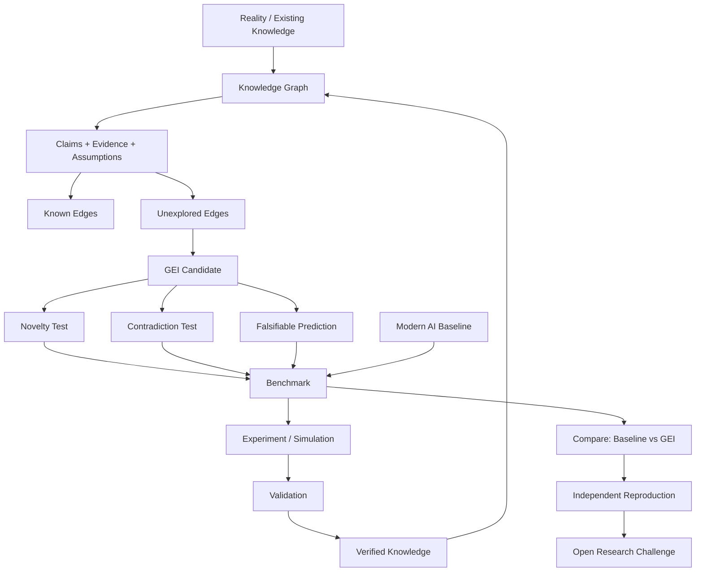

# GEI Visual Research Map

## Core mathematical object

\[
G=(V,E,X)
\]

- `V`: entities
- `E`: known relationships
- `X`: evidence, attributes, uncertainty, time

The search space is the complement of the known edge set:

\[
E^*=\{(u,v):u,v\in V,\ u\neq v,\ (u,v)\notin E\}
\]

GEI prioritizes candidates using measurable properties such as novelty, cross-domain connectivity, falsifiability, testability, and redundancy penalty.

## Research claim ladder

**Level 1:** GEI finds different/higher-quality candidate edges than a baseline.

**Level 2:** candidates survive deduplication and provenance checks against a reference corpus.

**Level 3:** candidates produce previously unknown, reproducible empirical results.

The project should not treat Level 1 as proof of Level 3.

## How to contribute

Try to break the system. Find a case where GEI's proposed edge is already known, trivial, unsupported, or unfalsifiable. Add the evidence and reproduce the failure.
