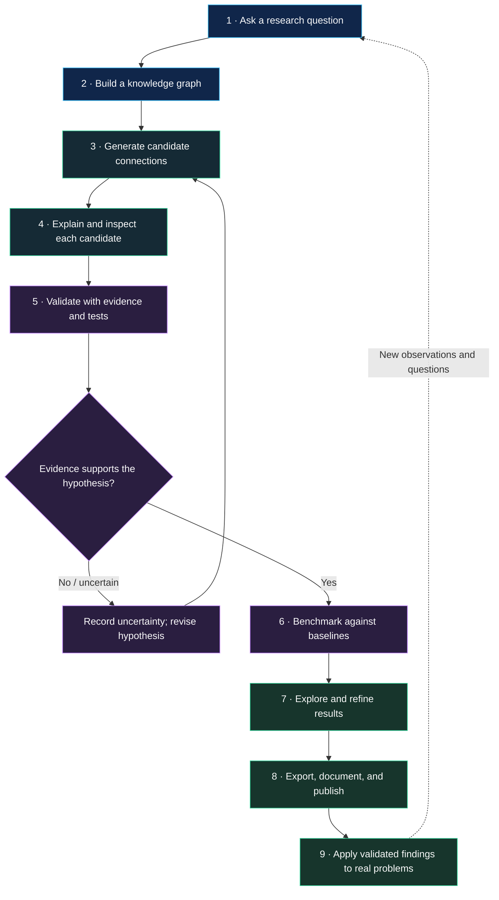

# GEI Discovery Lab — Workflow Diagram

> **Status:** conceptual workflow for the research prototype. Candidate scores and examples are illustrative; discoveries require independent validation.

## End-to-end workflow

## What each stage does

| Stage | Purpose | Output |
|---|---|---|
| Ask | Define a concrete question | Research question |
| Build | Organize claims and known relationships | Knowledge graph |
| Discover | Rank unconnected candidate pairs | Candidate list with explanations |
| Validate | Check evidence, contradictions, and testability | Testable hypotheses and uncertainty notes |
| Benchmark | Compare with appropriate baselines | Reproducible evaluation report |
| Explore | Inspect and refine candidates | Reviewed findings |
| Publish | Export results and methods | Shareable artifacts |
| Apply | Investigate potential practical use | Follow-up experiments |

## Research integrity

- A high score is a **candidate signal**, not proof of a true relationship.
- Use held-out examples and prevent evaluation leakage.
- Report the dataset, scoring method, baseline, sample size, and limitations.
- Do not present synthetic examples as real-world validation.
- Treat real-world impact as a hypothesis until measured.

## Live prototype

[Open GEI Discovery Lab](https://blind-multicolored-cubase--anuragdongare1.replit.app)

## Source repository

[Geometric-Engine-Intelligence](https://github.com/Anurag1/Geometric-Engine-Intelligence-)
