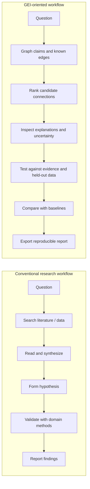

# Traditional Research Workflow vs. GEI Discovery Workflow

> **Purpose:** explain the intended workflow difference, not claim proven performance superiority. GEI is a research prototype; its advantages must be tested on independent, representative datasets.

## At a glance

| Dimension | Traditional / conventional workflow | GEI-oriented workflow |
|---|---|---|
| Starting point | Researcher frames a question and searches literature or datasets | Same starting point, with explicit graph-based representation of claims and relationships |
| Knowledge organization | Notes, documents, spreadsheets, databases, or domain-specific graphs; structure varies by project | Represent concepts/claims as nodes and known relationships as edges in a common graph |
| Finding connections | Researcher-driven search, domain expertise, keyword searches, and existing analysis tools | Generate and rank candidate unconnected pairs using explicit, inspectable heuristics |
| Why a candidate appears | May be spread across notes, search results, and expert judgment | Expose component scores and the signals that contributed to the ranking |
| Contradictions and assumptions | Often handled through literature review, critical reading, and domain-specific checks | Make contradiction/assumption review an explicit step in the proposed workflow |
| Validation | Depends on researcher, domain standards, and available methods | Treat each candidate as unverified until checked against evidence and testable hypotheses |
| Benchmarking | May use established evaluation protocols, expert review, ablations, or baselines | Intended to compare candidate rankings with baselines on held-out data; methodology must be appropriate to the task |
| Reproducibility | Depends on documentation, saved data, scripts, and process discipline | Aim to record input data, scoring method, parameters, baselines, and exported results |
| Human role | Researcher defines, interprets, challenges, and validates findings | Researcher remains responsible for interpretation, validation, and deciding what merits further study |
| Main limitation | Manual search can be fragmented or time-consuming; established workflows vary widely | Heuristic rankings can create false positives, miss important links, and inherit dataset bias or leakage |

## Side-by-side process

## What GEI is trying to add

1. **Explicit relationship map:** keep claims and known links in a graph so candidate relationships can be inspected.
2. **Ranked candidates:** prioritize possible missing connections for human review rather than treating every pair equally.
3. **Inspectable scoring:** expose the heuristic signals behind a ranking.
4. **Validation-first discipline:** separate candidate generation from evidence-based confirmation.
5. **Baseline comparison:** test whether ranking quality exceeds simple alternatives on held-out examples.
6. **Reproducible artifacts:** document datasets, parameters, metrics, and limitations.

## What has and has not been established

**Implemented/research-prototype direction:** a graph-based candidate-ranking demonstration and a synthetic benchmark workflow exist in the project. Synthetic results are illustrative and do not establish real-world effectiveness.

**Not established:** that GEI is generally more accurate, faster, more creative, or scientifically superior to conventional research. The right comparison depends on domain, dataset, baseline quality, evaluation design, and expert review.

## How to test the difference fairly

- Select a specific domain and a representative, documented dataset.
- Define positive and negative links before tuning the scoring method.
- Split training/development data from a truly held-out test set; prevent edge or feature leakage.
- Compare GEI with simple baselines (e.g., random ranking and lexical similarity) and a credible domain-specific baseline.
- Report Precision@k, Recall@k where labels permit, uncertainty intervals, runtime, and error examples.
- Run ablations to identify which scoring components actually help.
- Ask independent domain reviewers to assess candidate usefulness without knowing which method proposed them.
- Publish code, data provenance, configuration, and limitations so others can reproduce the results.

## Links

- [Live GEI Discovery Lab](https://blind-multicolored-cubase--anuragdongare1.replit.app)
- [GEI workflow diagram](./GEI_WORKFLOW_DIAGRAM.md)
- [Repository](https://github.com/Anurag1/Geometric-Engine-Intelligence-)

**Bottom line:** conventional research methods provide essential search, synthesis, and validation practices. GEI proposes an additional structured layer for surfacing and prioritizing candidate connections. Whether that layer improves outcomes is an empirical question to be answered by fair benchmarking—not assumed in advance.
